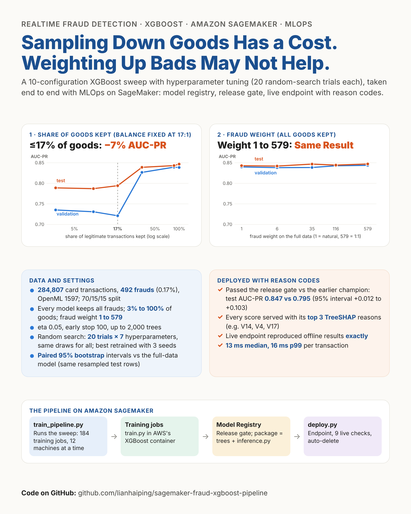
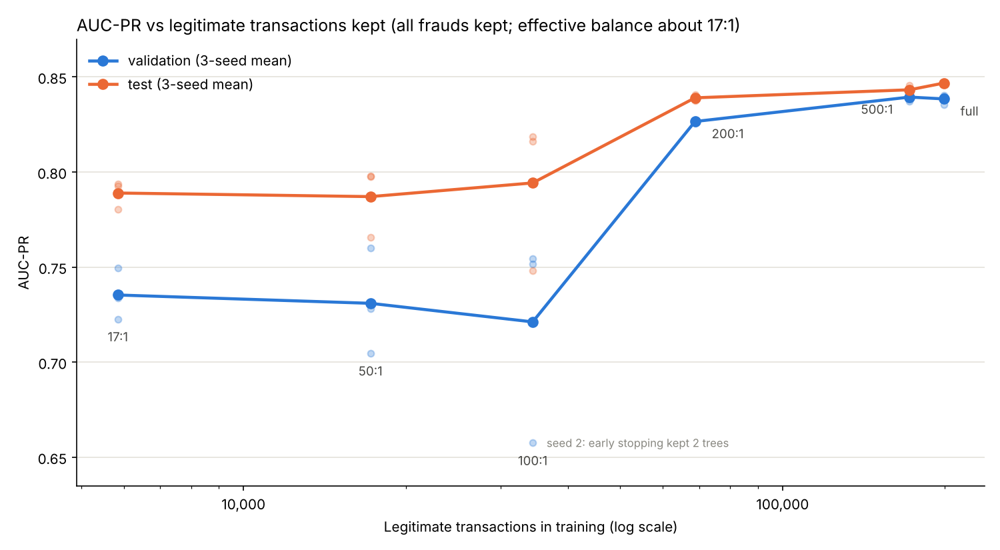
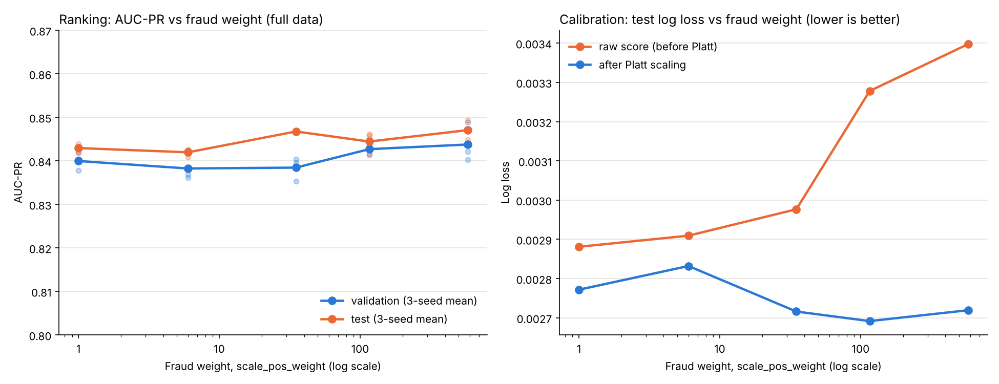
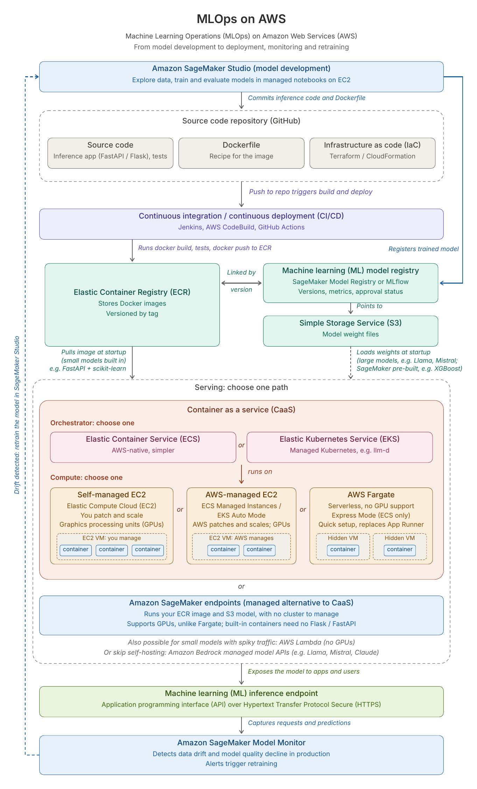

# Realtime fraud detection with XGBoost on Amazon SageMaker

A production-style training and deployment pipeline for an XGBoost fraud model on Amazon SageMaker, and a 10-configuration experiment run through it: **how many legitimate ("good") transactions does a fraud model need, and how much should the frauds be weighted?**



**Findings** (full results: [docs/RESULTS.md](docs/RESULTS.md))

- **Sampling down goods has a cost.** With the class balance held constant, keeping 17% or less of the legitimate transactions (34,000 or fewer of 199,020) cost about 7% of test AUC-PR (0.79 vs 0.85) and made results swing widely with the random seed. Keeping 35% (68,800) cost about 1%; at 86% (172,000) the loss disappeared.
- **Weighting up bads may not help.** On the full data, fraud-class weights from 1 (the natural 579:1 rate) to 579 (fully balanced, 1:1) gave the same ranking quality: every 95% interval includes zero. Heavier weights only shifted the raw probabilities, which Platt calibration corrected, so ranking and calibration need to be evaluated separately.
- **Taking it to production.** The best model passed a release gate against the earlier champion (test AUC-PR 0.847 vs 0.795, 95% interval +0.012 to +0.103), was deployed with **TreeSHAP reason codes served with every score**, reproduced the offline scores exactly on a live endpoint, and answered single transactions in 13 ms (median) and 16 ms (p99).





## Repository layout

```
sagemaker-fraud-xgboost-pipeline/
├── README.md
├── LICENSE
├── requirements.txt
├── .gitignore
├── pipeline/
│   ├── train_pipeline.py      training pipeline: the sweep, release gate, registry, packaging
│   ├── train.py               training code run inside SageMaker's XGBoost container
│   ├── inference.py           serving code packaged with the model: score + reason codes
│   └── deploy.py              deployment pipeline: deploy, live checks, latency, delete
├── docs/
│   ├── RESULTS.md             the experiment, results and conclusions
│   ├── LINKEDIN_POST.md       the LinkedIn write-up of the findings
│   └── architecture/          MLOps on AWS diagram (PNG and printable PDF)
└── results/
    ├── figures/               charts and the summary infographic
    └── tables/                per-configuration and per-seed results, deployment report
```

| File | What it does |
| --- | --- |
| `pipeline/train_pipeline.py` | Runs from a SageMaker Studio terminal. Prepares one training file per configuration, runs the random hyperparameter searches in rolling waves within the account's machine quota, retrains each best setting with 3 seeds, scores all models on validation and test (ranking, operating points, calibration before and after Platt scaling), computes bootstrap intervals, draws the charts, then gates the best configuration against the registry's champion (a material lift and an interval above zero) and packages it for the SageMaker Model Registry. `--repackage-version N` re-registers an existing model with the reason-code serving code, without training. |
| `pipeline/train.py` | Training code SageMaker runs inside AWS's XGBoost container (script mode): reads the data channels, trains with early stopping on validation AUC-PR, keeps only the best trees, saves the model. |
| `pipeline/inference.py` | Serving code packaged inside the model archive. For each transaction: raw score, calibrated probability, a 0-100 score, the alert flag and the top 3 TreeSHAP reason codes (XGBoost's `pred_contribs`), optionally only for alerts. |
| `pipeline/deploy.py` | Deploys the latest approved registry version as a real-time endpoint, checks it reproduces the offline results and serves reason codes, measures latency, reads CloudWatch, and always deletes the endpoint at the end (`--all`). |
| `docs/RESULTS.md` | Design, data, settings, both stories, the release-gate lesson, deployment with reason codes, conclusions. |

## How it works



The diagram shows the general MLOps flow on AWS (printable version: [MLOps_on_AWS_diagram.pdf](docs/architecture/MLOps_on_AWS_diagram.pdf)). This project follows the SageMaker path, using AWS's prebuilt XGBoost containers for training and serving ("script mode"): AWS provides and patches the images, and this repository's code decides what runs and what each container does. No Dockerfile is needed.

| Level | Code | Where it runs | What it controls |
| --- | --- | --- | --- |
| Orchestration | `train_pipeline.py`, `deploy.py` | Studio terminal (or any machine with AWS access) | Which models are trained, how they are compared and approved, registration, deployment, live checks, clean-up |
| Inside the containers | `train.py`, `inference.py` | AWS's XGBoost images on SageMaker machines | How one model is trained; how one request is answered (score and reasons) |
| Infrastructure | none | AWS | Images, machines, S3, Model Registry, endpoints, CloudWatch |

```
train_pipeline.py (Studio terminal)
  ├─ uploads one training file per configuration to S3
  ├─ 20-trial random search per configuration ──► SageMaker training jobs (XGBoost container runs train.py)
  ├─ 3 seeds of each best setting             ──► SageMaker training jobs
  ├─ scores every model, bootstrap intervals, charts
  └─ release gate, then registers model.tar.gz = trees + inference.py ──► SageMaker Model Registry

deploy.py (Studio terminal)
  ├─ latest Approved version ──► real-time endpoint (XGBoost serving image 3.0-5 runs inference.py)
  ├─ smoke test with reason codes, full test-set reproduction, latency, CloudWatch
  └─ deletes the endpoint (always, with --all)
```

## Running it

Requirements: an AWS account with SageMaker Studio, a training quota of at least 12 to 15 ml.m5.xlarge instances, and the packages in `requirements.txt`. No credentials go in the code: inside Studio the scripts use the space's IAM role. Pin XGBoost 2.1.4 locally: models re-saved for the registry must be readable by the 3.0 serving image.

```bash
pip install -r requirements.txt
# from the repository root
nohup python pipeline/train_pipeline.py > sweep.log 2>&1 &     # the sweep (about 35-60 minutes); registry untouched
python pipeline/train_pipeline.py --register-only outputs/<run>/register/<config>   # register the gated candidate
python pipeline/train_pipeline.py --repackage-version 4         # re-register a model with reason codes, no training
python pipeline/deploy.py --all                                 # deploy, test, delete
```

If the registry has no approved model yet, the gate becomes a minimum test AUC-PR (`min_auc_pr_first`, default 0.70). The sweep reuses earlier training jobs when they exist in the account (`CFG["reuse"]`); elsewhere every configuration is trained.

**Cost:** about 184 short training jobs for the sweep, a few dollars in total. An endpoint bills by the hour while it exists (ml.m5.xlarge about $0.23 an hour in us-east-2), which is why `deploy.py --all` deletes it in a `finally:` block.

## Data

Credit card fraud dataset ([OpenML 1597](https://www.openml.org/d/1597)): 284,807 transactions by European cardholders over two days in September 2013, 492 frauds (0.17%), 28 anonymized PCA features plus the amount. The scripts download it themselves; no data is stored in this repository. With anonymized features, reason codes name features (for example "V14") rather than plain-language reasons; a production system maps each feature to an approved reason text.

## License

MIT. See [LICENSE](LICENSE).
