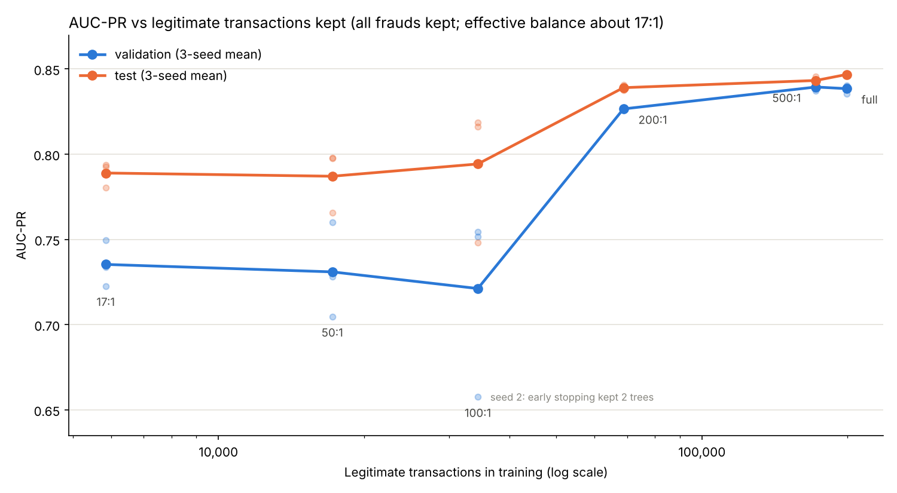
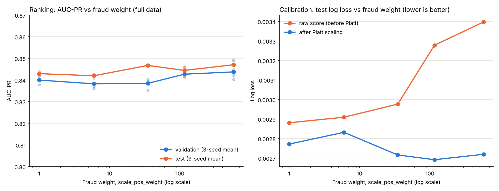

# Results: how many good transactions, and how much fraud weight, does an XGBoost fraud model need?

**Short answer: keeping enough legitimate ("good") transactions mattered far more than how the frauds were weighted.**

- **Story 1, volume.** With the class balance held constant (about 17 goods per weighted fraud), models trained on 5,800 to 34,000 goods lost about 0.05 to 0.06 test AUC-PR against the full data (199,020 goods), and their results swung widely with the random seed. At 68,800 goods the loss shrank to 0.008; at 172,000 it disappeared. Down-sampling at 200:1 or more cost little here; 100:1 or less cost a lot.
- **Story 2, balance.** On the full data, fraud weights from 1 (the natural 579:1 rate) to 579 (fully balanced, 1:1) produced the same ranking quality: every 95% interval against the reference includes zero. Heavier weights only distorted the raw probabilities (log loss up 18% at 1:1), and Platt calibration removed that completely.
- **Production.** The winning model (v4) passed the release gate against the earlier champion (+0.052 test AUC-PR, interval +0.012 to +0.103), was redeployed as v5 with **TreeSHAP reason codes served with every score**, reproduced the offline results exactly on a live endpoint, and answered single transactions in 13 ms (p50) and 16 ms (p99).





## Design

Ten configurations, all produced by `pipeline/train_pipeline.py` with the same training code (`pipeline/train.py`, running inside AWS's XGBoost 1.7-1 container on SageMaker training jobs). Every configuration keeps all 344 training frauds.

| Configuration | Story | Goods kept | Goods per fraud | Fraud weight | Effective balance |
| --- | --- | --- | --- | --- | --- |
| r17 | volume | 5,848 | 17 | 1 | 17.0:1 |
| r50 (registry v3) | volume | 17,200 | 50 | 3 | 16.7:1 |
| r100 | volume | 34,400 | 100 | 6 | 16.7:1 |
| r200 | volume | 68,800 | 200 | 12 | 16.7:1 |
| r500 | volume | 172,000 | 500 | 29 | 17.2:1 |
| full-w35 (registry v4, the reference) | both | 199,020 | 579 | 35 | 16.5:1 |
| full-w1 | balance | 199,020 | 579 | 1 | 578.5:1 (natural) |
| full-w6 | balance | 199,020 | 579 | 6 | 96.4:1 |
| full-w116 | balance | 199,020 | 579 | 116 | 5.0:1 |
| full-w579 | balance | 199,020 | 579 | 579 | 1.0:1 (balanced) |

- **Story 1** changes only the volume of goods: the fraud weight follows the sampling ratio, so every model sees frauds with the same relative importance.
- **Story 2** changes only the weight, always on the full data.
- **Identical treatment:** the same 7-parameter random search with the same 20 draws (tuner seed 42), the best settings retrained with XGBoost seeds 1, 2 and 3, and every seed model scored on validation and test. Each sampled configuration is its own random draw of goods (seed 42), and r50 reproduces the earlier challenger A exactly.
- **Reused runs:** r50 and full-w35 are the earlier A-vs-B challengers (registry v3 and v4); their jobs were reused, so their numbers are identical to the earlier report.

## Data

| Item | Value |
| --- | --- |
| Dataset | Credit card fraud, OpenML 1597 (European cardholders, September 2013, 2 days) |
| Rows / frauds | 284,807 / 492 (0.17%) |
| Features | 29: V1 to V28 (PCA components) and Amount |
| Split | 70 / 15 / 15, stratified by class, `random_state=42` |
| Train / validation / test | 199,364 (344 frauds) / 42,721 (74) / 42,722 (74) |
| Duplicates | 1,786 test rows (4.18%) are identical to a training row; a deduplicated AUC-PR is reported as a check |

Only training sets are sampled. Validation and test keep the real 0.17% fraud rate. With 74 frauds in each, differences below about 0.01 AUC-PR are within noise, which is why every comparison uses 3 seeds and a bootstrap interval.

## Training settings

**Fixed for every trial and configuration**

| Setting | Value | Why |
| --- | --- | --- |
| `objective` | `binary:logistic` | outputs a fraud probability |
| `eval_metric` | `aucpr` | precision-recall area: the right measure at 0.17% fraud |
| `tree_method` | `hist` | binned split search, much faster |
| `eta` (learning rate) | 0.05 | small steps, more trees, steadier models |
| `num_round` (tree cap) | 2,000 | a ceiling; early stopping decides |
| `early_stopping_rounds` | 100 | stop when validation AUC-PR has not improved for 100 rounds; the saved model keeps only trees up to the best round |

**Searched (random search, 20 trials per configuration, 4 machines at a time, 3 searches at once)**

| Hyperparameter | Range | Scale |
| --- | --- | --- |
| `max_depth` | 3 to 8 | integer |
| `min_child_weight` | 1 to 10 | logarithmic |
| `subsample` | 0.6 to 1.0 | linear |
| `colsample_bytree` | 0.5 to 1.0 | linear |
| `gamma` | 0 to 5 | linear |
| `lambda` (L2) | 0.1 to 10 | logarithmic |
| `alpha` (L1) | 0.001 to 10 | logarithmic |

**Infrastructure:** 184 new training jobs (8 configurations × 23) on ml.m5.xlarge, run in rolling waves within a 15-machine quota; about 35 minutes end to end, including scoring and bootstrap intervals.

## Story 1: volume of good transactions

3-seed means; the interval is the 95% bootstrap interval of test AUC-PR minus the full data (1,000 resamples).

| Goods kept (ratio) | Validation AUC-PR | Test AUC-PR | Test, duplicates removed | Test vs full data, 95% interval | Validation seed range |
| --- | --- | --- | --- | --- | --- |
| 5,848 (17:1) | 0.7353 | 0.7890 | 0.7803 | −0.099 to −0.018 | 0.027 |
| 17,200 (50:1, v3) | 0.7309 | 0.7871 | 0.7763 | −0.094 to −0.014 | 0.055 |
| 34,400 (100:1) | 0.7212 | 0.7943 | 0.7845 | −0.064 to −0.005 | 0.097 |
| 68,800 (200:1) | 0.8266 | 0.8390 | 0.8317 | −0.017 to −0.002 | 0.001 |
| 172,000 (500:1) | 0.8394 | 0.8432 | 0.8361 | −0.011 to +0.001 | 0.004 |
| 199,020 (full, v4) | 0.8385 | 0.8468 | 0.8398 | reference | 0.005 |

- **Below about 35,000 goods, the cost is large:** about −0.05 to −0.06 on test and −0.10 to −0.12 on validation, with intervals well below zero.
- **At 68,800 goods it is small but real** (−0.008 on test, interval just below zero); **at 172,000 it is gone** (interval includes zero).
- **Small samples are unstable.** Seed ranges on validation are 0.03 to 0.10 below 35,000 goods, against 0.001 to 0.005 above 68,800. Part of this is a fragile early stop: r100's seed 2 stopped after **2 trees** (validation 0.658) because validation AUC-PR peaked by chance in the first rounds and did not improve for 100 rounds; r50's seed 2 kept only 83 trees. Without its collapsed seed, r100 averages 0.753 on validation and 0.817 on test, so the curve rises steadily with volume. The table reports the 3-seed means as measured.
- **Where exactly the curve flattens is approximate.** Each ratio is a separate random sample, and the evaluation sets hold 74 frauds each, so "between about 35,000 and 70,000 goods" is as precise as these data allow.

**A closer look at 50:1 vs the full data (v3 vs v4).** Both searches tried the same 20 hyperparameter combinations. Six appear in both top-10 lists, and with identical settings the full data scores higher every time:

| max_depth | min_child_weight | subsample | colsample | gamma | lambda | alpha | v3 AUC-PR | v4 AUC-PR | Lift |
| --- | --- | --- | --- | --- | --- | --- | --- | --- | --- |
| 7 | 1.237 | 0.672 | 0.819 | 1.011 | 2.374 | 0.002 | 0.7343 | 0.8402 | +0.1059 |
| 7 | 2.267 | 0.775 | 0.504 | 0.525 | 0.936 | 0.006 | 0.7426 | 0.8400 | +0.0974 |
| 6 | 3.933 | 0.851 | 0.543 | 1.467 | 4.119 | 0.017 | 0.7360 | 0.8326 | +0.0966 |
| 5 | 2.849 | 0.933 | 0.535 | 1.597 | 0.934 | 0.016 | 0.7445 | 0.8340 | +0.0895 |
| 6 | 2.979 | 0.937 | 0.570 | 0.502 | 0.838 | 0.099 | 0.7491 | 0.8381 | +0.0890 |
| 4 | 3.671 | 0.668 | 0.511 | 0.516 | 0.286 | 3.420 | 0.7561 | 0.8345 | +0.0784 |

The gain is not hyperparameter luck. The sample also preferred heavier regularization (v3's best: depth 8, min_child_weight 7.7, gamma 2.5; v4's best: depth 7, min_child_weight 1.2, gamma 1.0): with fewer rows, each leaf needs more evidence. On test, every v4 seed beat every v3 seed (worst v4 0.8466, best v3 0.7978), and v3's mean (0.787) would have failed the gate against the earlier champion (0.795).

## Story 2: fraud weight on the full data

| Fraud weight (effective balance) | Validation AUC-PR | Test AUC-PR | Test vs weight 35, 95% interval | Raw log loss | Log loss after Platt | Platt a / b |
| --- | --- | --- | --- | --- | --- | --- |
| 1 (579:1, natural) | 0.8400 | 0.8429 | −0.010 to +0.001 | 0.00288 | 0.00277 | −0.06 / 0.87 |
| 6 (96:1) | 0.8382 | 0.8420 | −0.011 to +0.001 | 0.00291 | 0.00283 | −0.58 / 0.89 |
| 35 (17:1, v4) | 0.8385 | 0.8468 | reference | 0.00298 | 0.00272 | −0.76 / 0.77 |
| 116 (5:1) | 0.8427 | 0.8444 | −0.006 to +0.004 | 0.00328 | 0.00269 | −0.99 / 0.65 |
| 579 (1:1, balanced) | 0.8438 | 0.8471 | −0.005 to +0.005 | 0.00340 | 0.00272 | −1.31 / 0.63 |

- **Ranking does not depend on the weight.** All five land within 0.005 AUC-PR on test, and every interval includes zero. Detection and value detection at 5:1 are the same for all (85.1% / 50.1%).
- **The weight shows up in calibration.** Heavier weights push raw scores up, so the raw log loss rises steadily (+18% at 1:1 against the natural rate) and the Platt intercept moves from −0.06 to −1.31 to pull scores back down. After Platt scaling, every weight is equally well calibrated.
- **The mean predicted rate stays near the true 0.17% at every weight,** unlike the textbook picture of heavily inflated probabilities. On data this separable, almost every legitimate transaction lands in a leaf with a near-zero score whatever the weight; the distortion is concentrated in the uncertain middle of the range, which log loss captures.
- **Heavier weights trained longer:** about 390 trees at weight 1, about 650 to 850 at weights 116 and 579.

So the common advice to "balance the classes to 1:1" made no difference to ranking here, and it needs calibration afterwards. Weighting the frauds is a convenience, not a source of accuracy; keeping the goods is.

## Release gate: a lesson from the sweep

The pipeline picks the best configuration on validation and gates it on test against the current champion. Full data with weight 579 was best on validation (0.8438), and on test it scored 0.8471 against the champion's 0.8467: a gain of 0.0004, pure noise. The original rule, "the 3-seed mean beats the champion", would have approved it. The gate now requires **both** a material lift (at least 0.005 test AUC-PR) **and** a 95% bootstrap interval that lies entirely above zero. The candidate was not registered, and v4 remains the champion model.

## Deployment with reason codes (registry v5)

Reason codes are part of the deployed model, not a separate analysis. The registered package holds the trees and the serving code:

```
model.tar.gz
├── xgboost-model          v4's trees, unchanged
└── code/
    ├── inference.py       score, calibrated probability, 0-100 score, 5:1 alert flag, top 3 reasons
    └── scoring.json       Platt a and b, the 5:1 cutoff (full precision), feature names
```

The registry entry sets `SAGEMAKER_PROGRAM=inference.py`, so AWS's XGBoost 3.0-5 serving image runs our code for every request. Reasons come from XGBoost's built-in TreeSHAP (`pred_contribs=True`): each transaction's log-odds split exactly into one contribution per feature; the reasons are the largest positive ones. `train_pipeline.py --repackage-version 4` built v5 from v4's exact trees without training, recomputing calibration and the cutoff at full precision.

`pipeline/deploy.py --all` deployed v5, tested it and deleted the endpoint. All 9 checks passed:

| Check | Result |
| --- | --- |
| Served 0-100 score matches the registry calibration | largest gap 0.00 points |
| Every alert comes with reason codes | 4 of 4 |
| Smoke test (5 frauds, 5 legitimate) | 4 of 5 frauds alerted, 0 false alarms |
| Whole test set reproduces the offline results | AUC-PR 0.8467, detection rate 85.14%, value detection rate 50.07% |
| False positives per fraud at 5:1 | 326 for 63 frauds = 5.17, exactly as offline (v4's rounded cutoff had given 325) |
| Single-transaction latency (round trip from Studio) | p50 13.1 ms, p95 14.8 ms, p99 15.7 ms (v4 without reasons: 12.0 / 13.6 / 14.7) |

Example answers from the smoke test:

| Actual | Amount ($) | Score (0-100) | Alert at 5:1 | Top reasons |
| --- | --- | --- | --- | --- |
| fraud | 345.00 | 100.0 | yes | V14, V4, V17 |
| fraud | 1.00 | 100.0 | yes | V14, V4, V17 |
| fraud | 239.93 | 78.1 | yes | V17, V4, V12 |
| fraud | 276.17 | 52.8 | no | V14, V27, V17 |
| legitimate | 28.75 | 45.9 | no | V20, V7, V17 |

**The cost of reason codes:** about 1 ms per single transaction, negligible against a typical 50 to 100 ms fraud-scoring budget. In batches it dominates: a 1,000-row request took about 2 seconds of model time with every row explained, against 38 ms for scores alone. `inference.py` therefore has an option to explain only transactions that alert (`explain_alerts_only` in `train_pipeline.py`'s settings), which is how a batch rescoring job would use it. The features here are anonymized PCA components, so a reason reads "V14"; a production system maps each feature to an approved plain-language reason.

## Earlier results kept for reference

v4 against the first champion (v1, an untuned baseline), test set, thresholds chosen on validation:

| Test set | Champion v1 | v4 seed 1 | v4 seed 2 | v4 seed 3 |
| --- | --- | --- | --- | --- |
| Trees | 65 | 354 | 448 | 512 |
| AUC-PR | 0.7948 | 0.8467 | 0.8470 | 0.8466 |
| AUC-PR, duplicates removed | 0.7840 | 0.8397 | 0.8400 | 0.8397 |
| False positives per fraud caught at 5:1 | 5.24 | 5.17 | 5.16 | 5.11 |

The gain was +0.052 (95% interval +0.012 to +0.103). On the calibrated 0-100 score, at score 60 and above both catch 85.1% of frauds, but v4 raises 199 alerts instead of 254: about 29% fewer false positives. About 11 frauds holding half the fraud dollars score like ordinary purchases in every model; anonymized features offer no card history to catch them.

## Conclusions

1. **Keep enough goods.** At a constant class balance, models with 35,000 goods or fewer lost about 0.05 to 0.06 test AUC-PR and were unstable; from about 70,000 goods the loss was small, and at 172,000 it vanished. If you must sample, sample gently (200:1 or more here) and check the curve on your own data.
2. **Don't expect class weighting to buy accuracy.** From the natural rate to fully balanced, ranking was unchanged; heavier weights only needed more calibration. Calibrate (Platt) whatever weight you choose.
3. **Measure noise before claiming a difference.** Use several seeds, paired settings and bootstrap intervals; with 74 evaluation frauds, gains under 0.01 are not evidence.
4. **Gate releases on a material, significant lift.** "Mean beats champion" approved a 0.0004 gain.
5. **Serve reasons with the score,** from the same versioned package, and explain only alerts in batch.

## Files

**Charts:** [`volume_curve.png`](../results/figures/volume_curve.png), [`balance_curve.png`](../results/figures/balance_curve.png), [`v3_vs_v4_lift.png`](../results/figures/v3_vs_v4_lift.png), [`test_comparison.png`](../results/figures/test_comparison.png), [`score_strategy.png`](../results/figures/score_strategy.png).

**Tables:** [`sweep_summary.csv`](../results/tables/sweep_summary.csv) (one row per configuration), [`sweep_seeds.csv`](../results/tables/sweep_seeds.csv) (every metric for all 30 seed models), [`v3_v4_seed_scores.csv`](../results/tables/v3_v4_seed_scores.csv), [`test_report.csv`](../results/tables/test_report.csv), [`strategy_table.csv`](../results/tables/strategy_table.csv), [`deploy_report_v5.md`](../results/tables/deploy_report_v5.md).
